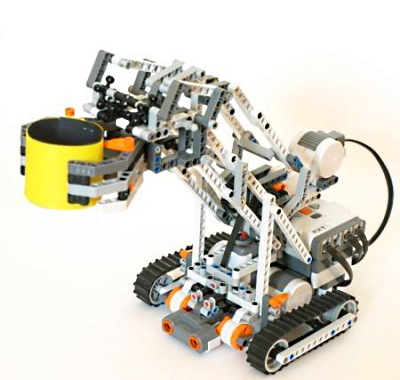
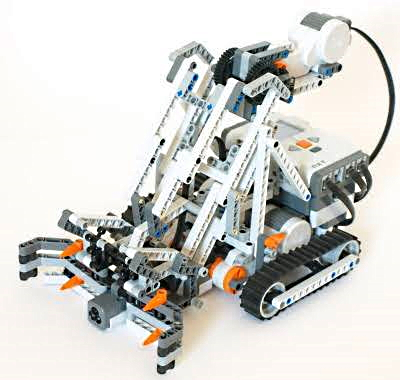
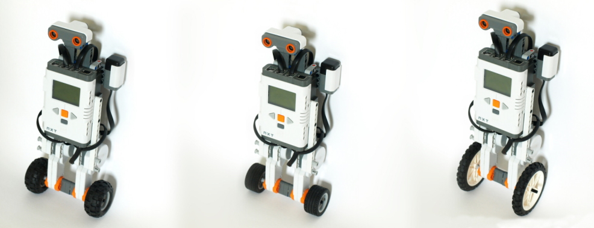
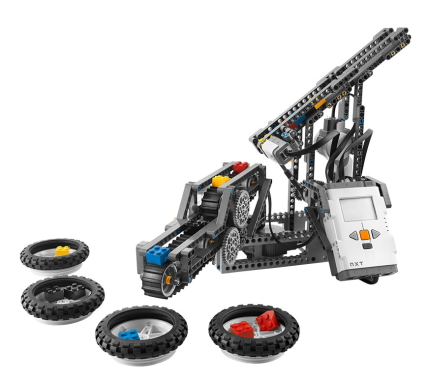

# LEGO Mindstorms NXT RobotC projects

A collection of [RobotC](https://www.robotc.net/) projects and code examples for the LEGO Mindstorms NXT 2.0 programmable brick.  
The repository contains code for several robots as well as standalone code examples that demonstrate basic robot control, motor movement, sensor usage, loops, conditionals, functions, and simple autonomous behaviors.

## Snatcher: the autonomous robotic arm
<table style="border: none; width: 100%;">
  <tr>
    <td style="text-align: center; border: none; vertical-align: middle;">
      
    </td>
    <td style="text-align: center; border: none; vertical-align: middle;">
      
    </td>
  </tr>
</table>

This project is a robot based on the LEGO Mindstorms NXT tracked platform with a single-DOF manipulator (up/down) designed to grasp and transport small objects. Lifting/lowering and gripping are driven by a single servomotor. The robot is equipped with distance, touch, and color sensors, and a gyroscope provides orientation and motion control on flat surfaces. Movement primitives include gyro-corrected straight driving, gyro-based rotation, turn-in-place, and coordinate-based navigation, while a dedicated claw task handles open, close, and hold behavior using the touch sensor and motor encoder.

The design was developed by [Laurens Valk](https://github.com/laurensvalk). 
Instructions for building and programming this robot are included in The LEGO MINDSTORMS NXT 2.0 Discovery Book.

The project is organized as a multi-mode application with an on-brick selection menu offering 14 programs: motor and claw self-test, nearest-object search and capture, random movement with return-to-start, wall avoidance, catch-all behavior, green/blue color selection, sonar/gyro/color/button viewers, sound playback, and Bluetooth joystick control. Bluetooth modes support slave, single-master, and dual-master operation. The robot can be controlled via Bluetooth using a remote that is designed like a joystick. The code for the joystick is also available in the repository.

Supporting modules provide filtered sensor tasks, Bluetooth packet handling and on-screen interface drawing, utility helpers, and separate gyro drivers for HiTechnic and MindSensors hardware. The code is split into snatcher.c (main application and menu), sensors.c, bluetooth.c, utils.c, and gyro driver files, making it easy to adapt the robot behavior or reuse the sensing and control layers in other NXT projects.

The touch sensor input is flexible: it can be a standard LEGO touch sensor connected directly to a sensor port, or a LEGO touch sensor sharing the same port with a PCF8574 I2C expander that drives an RGB backlight. In the shared-port configuration, the firmware temporarily switches the port to touch-sensor mode to read the button state, then switches it back to I2C mode to control the backlight, allowing both the claw touch input and the RGB status lighting to operate on a single sensor port.

## Segway: basic segway robotic platform

This project is a self-balancing Segway driver using a HiTechnic gyro, motor encoders, and a PID control loop to maintain upright balance while supporting speed, steering, and acceleration control. It includes reusable driver code plus example programs for standing still, driving by encoder distance, and sonar-based wall avoidance.

[Detailed description](http://robotsquare.com/2012/02/13/tutorial-segway-with-robotc/)

## Color sorter: simple robot for sorting cubes by color

This project is a color sorter for standard 2x2 LEGO cubes. It uses an NXT color sensor to detect red, green, blue, and yellow cubes, rotates a motorized transporter to color-specific encoder positions, pushes each cube with a touch-sensor-controlled pusher, and displays running counts per color on the NXT screen.

## Other RobotC examples

The repository also includes various code examples for working with sensors and motors in the RobotC language. 
There are also more complex examples demonstrating multitasking and connecting external devices via the I2C bus. 
All files are located in the `examples` directory.

## Requirements
- LEGO Mindstorms NXT 2.0
- RobotC for NXT
- NXT firmware
- USB or Bluetooth connection
