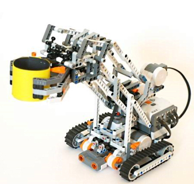
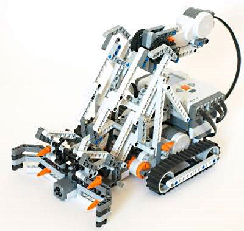
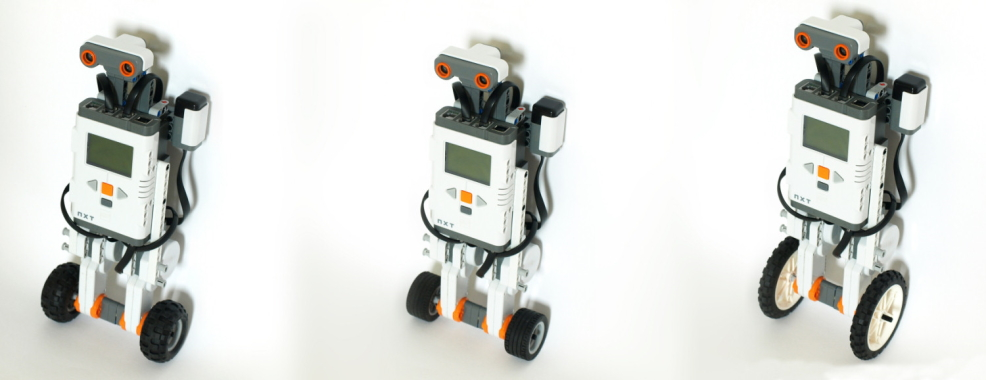
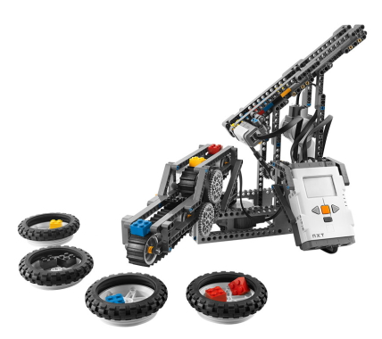

# LEGO Mindstorms NXT RobotC projects

A collection of [RobotC](https://www.robotc.net/) projects and code examples for the LEGO Mindstorms NXT 2.0 programmable brick.  
The repository contains code for several robots as well as standalone code examples that demonstrate basic robot control, motor movement, sensor usage, loops, conditionals, functions, and simple autonomous behaviors.

## Snatcher: the autonomous robotic arm
<table style="border: none; width: 100%;">
  <tr>
    <td style="text-align: center; border: none; vertical-align: middle;">
      
    </td>
    <td style="text-align: center; border: none; vertical-align: middle;">
      
    </td>
  </tr>
</table>
Built on a tracked platform, the robot features a manipulator designed to grasp and transport small objects. 
The manipulator has a single degree of freedom: it can only move up and down. 
Both functions—lifting/lowering and gripping—are controlled by a single servomotor. 
The robot is equipped with distance, touch, and color sensors. 
Since NXT controllers have four input ports, one port remains unused. 
The remaining port is used to connect a gyroscopic sensor. 
The gyroscope enables the robot to orient itself on a flat surface and control its movement.

The design was developed by [Laurens Valk](https://github.com/laurensvalk). 
Instructions for building and programming this robot are included in The LEGO MINDSTORMS NXT 2.0 Discovery Book.

## Segway: basic segway robotic platform

[Description](http://robotsquare.com/2012/02/13/tutorial-segway-with-robotc/)

## Color sorter: simple robot for sorting cubes by color

## Other RobotC examples

The repository also includes various code examples for working with sensors and motors in the RobotC language. 
There are also more complex examples demonstrating multitasking and connecting external devices via the I2C bus. 
All files are located in the `examples` directory.

## Requirements
- LEGO Mindstorms NXT 2.0
- RobotC for NXT
- NXT firmware
- USB or Bluetooth connection